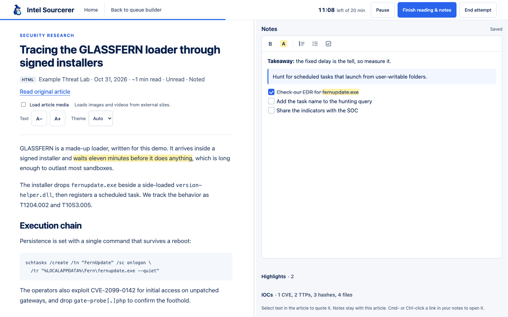
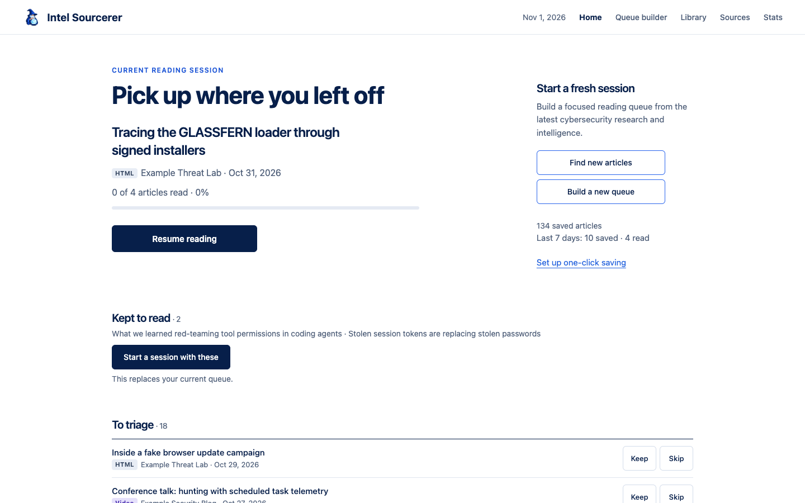
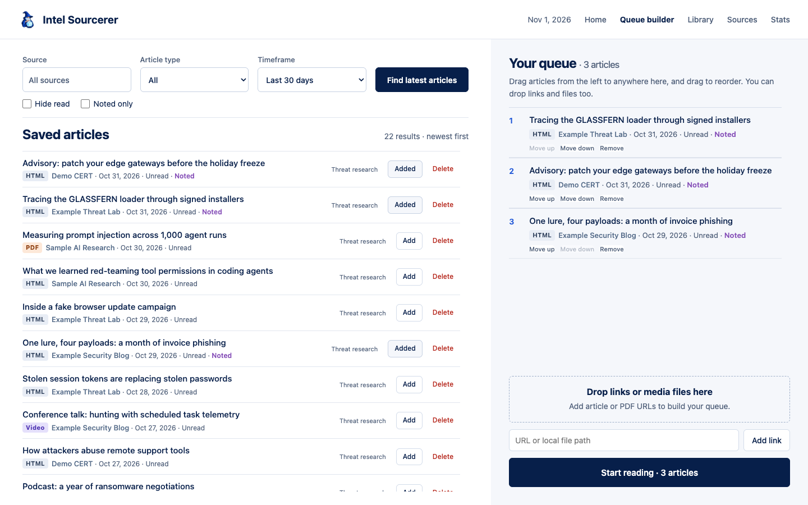
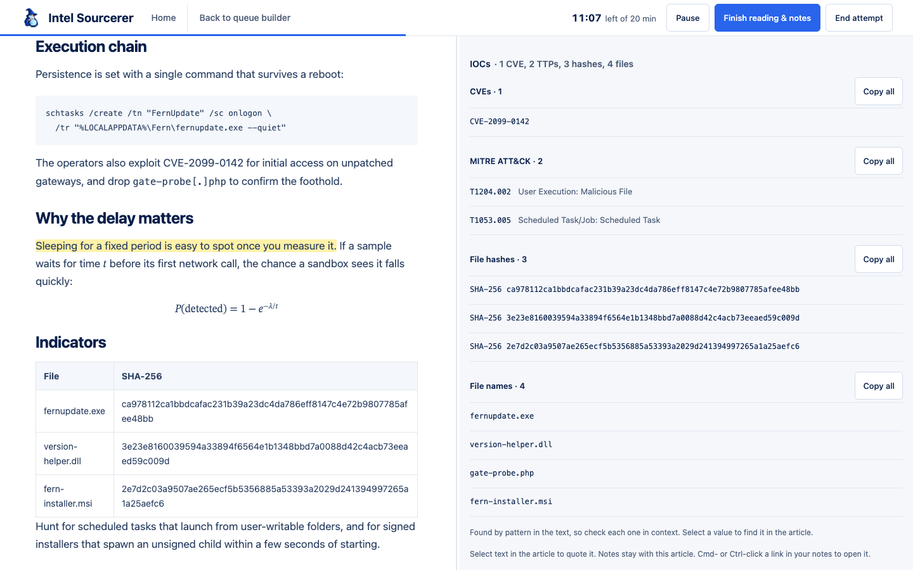
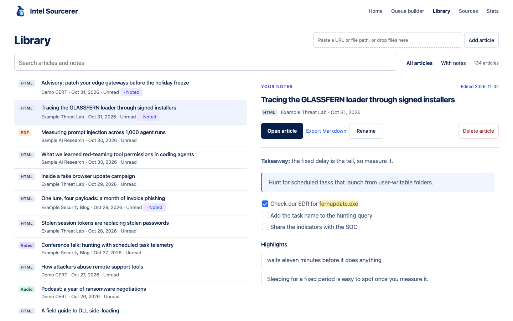
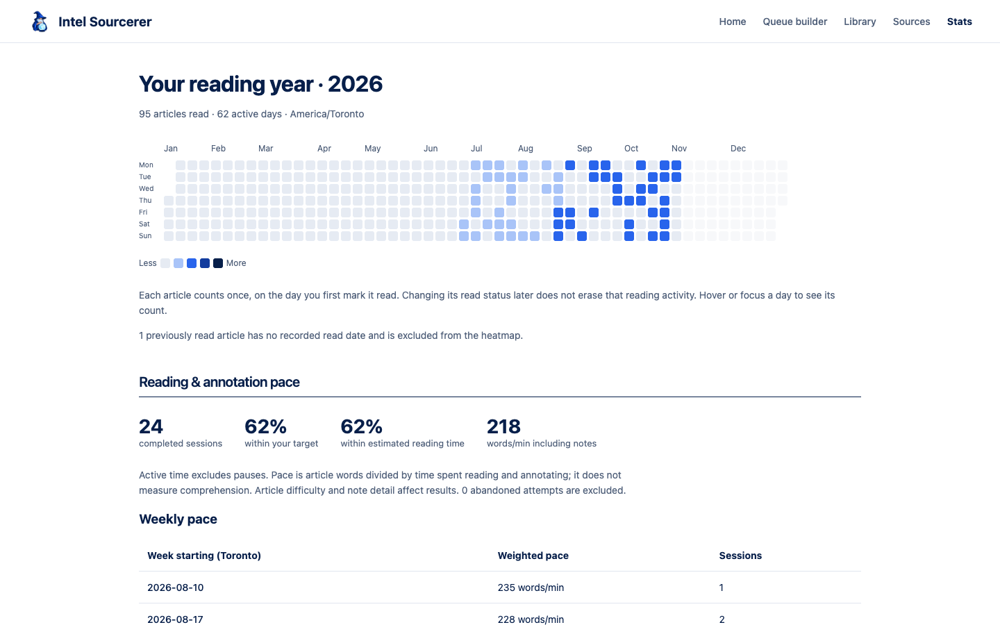
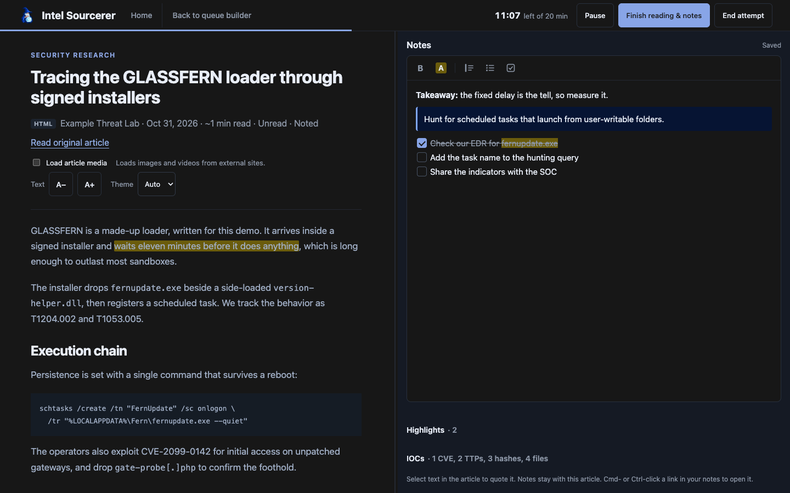
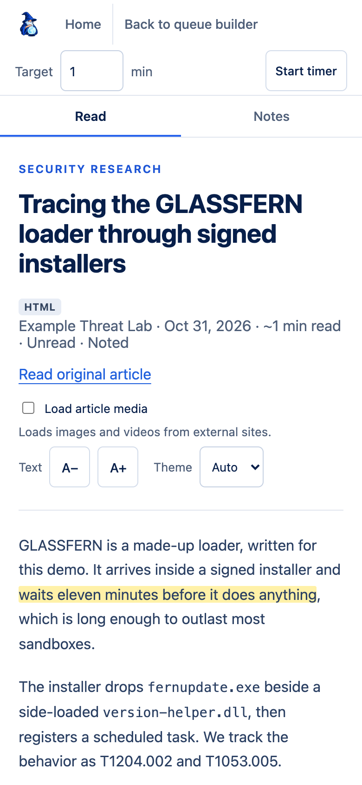
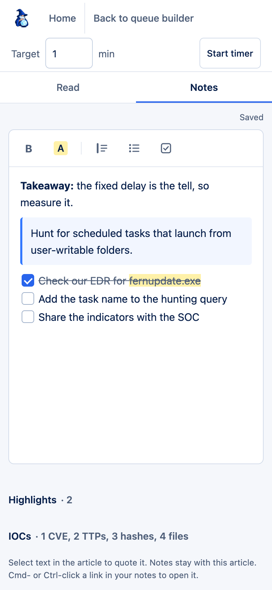

# Intel Sourcerer

A local cybersecurity reading workspace for collecting research articles, building focused reading queues, and keeping notes beside the full article.



## A look around

Every screenshot uses a made-up demo library: the articles, publishers, and indicators are invented.

**Home:** pick up your session, find new articles, and sort what's new with Keep or Skip.



**Queue builder:** filter saved articles and drag them into your queue.



**Indicators:** CVEs, MITRE IDs with their names, file hashes, and file names pulled from the article, ready to copy.



**Library:** search everything you've saved, with notes and highlights beside each article.



**Stats:** your reading year as a heatmap, with pace from timed sessions.



**Dark mode**, for long sessions.



**On a phone:** separate Read and Notes tabs, and the app can be installed for offline reading.

<p>
  
  
</p>

## Run locally

Requires Python 3.12+ and [uv](https://docs.astral.sh/uv/).

```sh
uv sync
uv run intel-sourcerer-web
```

Open [Intel Sourcerer](http://127.0.0.1:8765/). Run commands from the project root. One server on port 8765 serves both authenticated accounts and temporary guest reading; press Ctrl+C to stop it.

```sh
# Optional custom database and port
uv run intel-sourcerer-web --database data/intel_sourcerer.sqlite3 --port 8765

# Run tests
uv run pytest -q
```

## Run with Docker

Requires Docker with Compose (Docker Desktop or OrbStack).

```sh
docker compose up --build -d --wait
```

Open [Intel Sourcerer](http://127.0.0.1:8775/) and create your first account. The
server needs a one-time setup code for this, printed by
`docker compose logs backend`.
The `backend` container serves the interface and API. SQLite runs inside that
process; the `intel-data` named volume stores accounts, libraries, personal source
settings, uploads, and daily snapshots under `/app/data`. There is no separate
database server or container. This starts a fresh library and does not import or
modify your existing local `data/` directory. Private data and `.env` files are
excluded from the image build.

```sh
docker compose logs -f backend
docker compose down                 # Stop; saved data remains in the volume
docker compose up -d --wait         # Restart with the same saved data
docker compose up --build -d --wait # Rebuild after updating the application

# Optional: change the host port
INTEL_PORT=8875 docker compose up -d --wait
```

Do not use `docker compose down --volumes` unless you intend to delete the saved
Docker data. The port is published on localhost. For HTTPS or remote access, see
[Docker hosting and backups](docs/hosting.md#docker-with-persistent-sqlite).

## GitHub CI/CD and production hosting

The project includes GitHub Actions for tests, Docker image publication to GHCR,
and optional deployment to an AWS Lightsail VM. Production uses Caddy for HTTPS,
a persistent SQLite volume, pre-deploy backups, and recovery on failed releases.
See the [Lightsail setup guide](docs/lightsail.md) for server preparation,
GitHub secrets, deployment activation, and backups. Deployment remains disabled
until you configure the server and set `DEPLOY_ENABLED=true` in GitHub.

## Reading workflow

- **Home:** resume the current session, find new articles, build a new queue, and revisit saved note previews. **To triage** lists unread articles to Keep or Skip, with Undo and a bulk skip for anything older than 30 days. **Kept to read** starts a session from what you kept. Skipped articles leave the queue builder but stay in the Library. A line shows articles saved and read in the last 7 days.
- **Queue builder:** filter articles by searchable source, article type, and timeframe. Hide read articles or show noted articles using independent checkboxes. Find latest articles checks all enabled configured sources.
- **Your queue:** add/remove articles with the Add/Added button, drag saved articles anywhere in the queue section, drag to reorder, or use the ordering buttons. Over a queue row, a line shows which side the article lands on. Drop article URLs or files, or paste a link, to import a page manually.
- **Reading view:** read the saved article alongside autosaving notes. Resize the divider, select text to highlight it or quote it into notes, and format notes with bold, highlight, callouts, lists, and checklists. Quotes keep code blocks, links, and math as TeX. Text size and Auto/Light/Dark theme are at the top of each article. Next advances without changing read status; Mark read & next records the read and advances. Return to the builder with the current selection intact, or go Home.
- **Completion:** finishing the queue opens a centered popup. Starting another queue does not require finishing the previous one.
- **Library:** search titles, publishers, full saved article text, and notes, including disabled sources. Select a result to preview its formatted notes beside the article list; use With notes to narrow the list. Open an article without replacing your reading queue, or export its article and notes as Markdown. Articles sort by publication date, newest first.
- **Sources:** view configured publishers and toggle them on/off. Changes persist to the TOML configuration and database. Disabled sources stop appearing in discovery results; stored articles and notes are retained.
- **Stats:** this year's daily reading heatmap in America/Toronto time. Each article counts once on its first recorded read. Previously read articles without timestamps are excluded. Changing read status later does not erase activity.

Queues, reading position, highlights, and triage decisions persist in SQLite, so your place in an article follows you between devices; the most recent position wins. Browser storage retains queue drafts, note drafts, divider width, text size, theme, and media preferences. Notes are saved before leaving the reader; conflicting note edits are rejected to avoid overwriting newer changes.

## Sources and collection

Publisher configuration lives in [`config/sources.toml`](config/sources.toml). Each source has an ID, name, `source_type`, `enabled`, and `parent_url`; RSS URLs and notes are optional. Source types group publishers and do not restrict collection.

Collection supports RSS/Atom feeds and an Anthropic listing adapter. Enabled sources without a supported discovery method report an issue. Listing pagination is not implemented, so longer windows and All time do not guarantee a complete historical archive.

```sh
# Preview enabled RSS feeds as JSON, without saving articles
uv run intel-sourcerer

# Import relevant articles from enabled sources
uv run intel-sourcerer-import --since 2026-09-01
```

Cybersecurity relevance and article-type labels use keyword rules, not AI classification. They can miss articles or assign broad labels. Manual links bypass relevance filtering. If a manual page has no publication date, its import date is used. Adding an already saved manual URL preserves its existing copy.

## Saved articles and media

Articles are stored as sanitized HTML, which the reader displays, plus Markdown for export and older entries. Code, regex, tables, and math (rendered with KaTeX) survive as written, and PDFs keep their links, bullets, and code lines. Blog header images can be captured from Open Graph/Twitter metadata. Multi-section reports use the enclosing main content when it contains several separate article sections.

Site furniture is removed when an article is saved: tag and topic lists, navigation, share bars, product promos, and related-article cards (`boilerplate.py`). The rules match exact labels and link-only blocks, keep sections such as Footnotes, References, and Acknowledgements, and leave an article alone if they would remove more than half of it. Unusual sites can still leave some clutter. Markdown exports and Library search still use the original text. A category that a listing page ran into a title is also dropped when the article's own heading settles it.

```sh
# Re-fetch and re-parse articles that have no clean HTML yet (--all for every article)
uv run intel-sourcerer-reparse

# Apply the current furniture and title rules to saved articles, with no fetching
uv run intel-sourcerer-reparse --reclean --dry-run
uv run intel-sourcerer-reparse --reclean
```

Back up the database before running these on a library you care about.

**Load article media** optionally loads linked images, supported direct videos, and YouTube/Vimeo embeds from external hosts. Media is not downloaded into the database. JavaScript-rendered charts, dynamic content, and unsupported video players may not be captured. Original article and media links remain available.

The `/classic` route retains the earlier expandable article list.

## Storage and implementation

The default database is `data/intel_sourcerer.sqlite3`. Database files, SQLite sidecars, virtual environments, caches, and `.env` are ignored by Git. It contains your articles, notes, queues, and read history. Existing databases migrate automatically when opened.

The current app uses Python's threaded HTTP server, SQLite, and plain HTML/CSS/JavaScript—no frontend build step. Dependencies include httpx, feedparser, Beautiful Soup, Trafilatura, markdownify, markdown-it-py, and bleach. Reader and note HTML are sanitized; write endpoints require a CSRF token.

Key modules in `src/intel_sourcerer/`:

| Module | Purpose |
| --- | --- |
| `config.py`, `feeds.py` | Source configuration and RSS/Atom fetching |
| `importer.py`, `discovery.py` | Configured-source collection and manual links |
| `content.py`, `pdf_content.py`, `pdf_layout.py` | Clean HTML and Markdown extraction, media placeholders, rendering |
| `boilerplate.py`, `reparse.py` | Site furniture removal and rebuilding saved articles |
| `iocs.py`, `update_attack_names.py`, `attack_names.json` | Indicator extraction and the bundled MITRE name lookup |
| `storage.py`, `sessions.py`, `reading_state.py` | Articles, queues, notes, read history, highlights, positions, triage |
| `viewer.py`, `ui/`, page renderers | Stateless interface and backend gateway |
| `backend.py`, `web.py`, `auth.py`, storage modules | Private authentication and article API |

## Saving from anywhere

Home → **Set up one-click saving** opens `/save`, with a bookmarklet to drag to your bookmarks bar. On Android, install the app and use the Share menu. On iPhone, the page explains a Shortcut that opens the same link. Saving always needs one press on the page, so another site can't add articles to your library. The server fetches the page itself, so paywalled or logged-in articles won't save their full text.

## Phone and offline

Below 700px the reader switches to Read and Notes tabs, and the app can be installed from the browser over HTTPS or localhost. A service worker answers from the network first and falls back to a local copy. Your queue, kept articles, and the next unread articles are stored ahead of time, up to 30 at a time. Offline reading covers article text, not images from other sites. Notes written offline stay in the browser and are sent when the connection returns. Signing in or out clears the offline copies. Guest sessions are never cached.

## Indicators

The reader's **IOCs** panel lists what it finds in the article text, each group with **Copy all**, and selecting a value jumps to it in the article:

- **CVEs**, normalized to uppercase.
- **MITRE IDs** with their names: ATT&CK techniques, sub-techniques, and tactics (Enterprise, Mobile, ICS) and ATLAS. Retired IDs are marked. IDs that exist only in a link to an ATT&CK or CVE page count too.
- **File hashes:** MD5, SHA-1, SHA-256, and SHA-512.
- **File names**, including defanged ones and names inside paths. Everyday tools such as `cmd.exe` sit in their own group, so Copy all gives you just the samples.

Markdown exports include an Indicators section. Everything is found by pattern with no network lookups, so check values in context: a mention isn't a finding, and a hash-shaped value may not be a file hash. Copy all copies IDs without names.

The names come from a bundled lookup that doesn't update itself. After MITRE publishes a new version, rebuild it and restart the server:

```sh
uv run --with pyyaml python -m intel_sourcerer.update_attack_names
```

MITRE ATT&CK and ATLAS are © The MITRE Corporation. ATT&CK® is a registered trademark of The MITRE Corporation. This project isn't affiliated with or endorsed by MITRE.

## Planned work

AI summaries, article chat, scheduled collection, notifications, and richer extraction are future work. There is no automatic background polling or AI provider integration yet.

See [`docs/`](docs/) for source notes, design screenshots, and earlier architecture proposals. Those proposals describe possible future infrastructure rather than the current runtime.

## Automatic backups and recovery

Databases use SQLite's write-ahead log, so recent writes can sit in a `-wal` file beside the database and reads continue during a write. Keep the data directory on a local disk, not a network share. To copy a running database, use `sqlite3 data/intel_sourcerer.sqlite3 ".backup copy.sqlite3"`, because copying the main file alone can miss recent changes.

The web server creates one SQLite snapshot per UTC day in `data/backups/`, on startup or before the first note save that day. Existing daily snapshots are kept unchanged. These are daily recovery points, not continuous backups; later edits may not be in that day's snapshot. Snapshots stay local, are ignored by Git, and are not automatically pruned. Copy important snapshots to separate storage for protection against disk loss.

To restore a snapshot:

1. Stop the web server and any import processes.
2. Move the current database and any matching `-wal` and `-shm` sidecars to a separate recovery folder. Keep them until you have verified the restore.
3. Copy the desired file from `data/backups/` to `data/intel_sourcerer.sqlite3` (or your configured database path).
4. Restart the server and check your articles and notes. Restoring also restores queues and read history to the snapshot date.

Browser-local unsaved note drafts may conflict with restored notes. Preserve any draft you want to keep before dismissing a conflict.

## Editing the UI

Page layouts and their JavaScript live together under `src/intel_sourcerer/ui/`. See [the UI guide](src/intel_sourcerer/ui/README.md) for the file map and rendering conventions. The shared stylesheet is `ui/shared/styles.css`.

## Timed reading and notes

In the reader's header, choose a target (defaults to the article reading estimate) and start the timer. A blue line along the bottom of the header fills as time passes. Pause/resume excludes paused time; switching tabs or leaving through reader navigation pauses automatically. Reloads retain the session. Overtime keeps counting. Finish reading & notes saves notes first, records the attempt, and marks the article read without advancing the queue. End attempt records an abandoned attempt separately.

Stats shows completion rates against your target and the default 200-word/minute estimate, weighted reading-and-annotation pace, weekly summaries, and recent sessions. Pace measures article words per active minute, including time spent taking notes; it does not measure comprehension. Abandoned attempts are excluded. Only one timer can be active at a time. Deleting an article deletes its timed sessions too.

### More media in your queue

The Library and Queue Builder accept links, local paths, and file drops:

- Audio: MP3, M4A, OGG, WAV URLs or local files. Podcast RSS links import the first available audio episode. The reader offers playback speed and **Add timestamp to notes**.
- Newsletters: public newsletter pages use the article importer; exported `.eml` messages preserve their subject, sender, and readable body. Remote email images still use the media toggle. Inbox connection and paywall access are not included.
- Slides: `.pptx` files or direct links import slide text, figures, tables, and speaker notes in slide order. PDF slides use the PDF parser. Full slide layout/animations are not reproduced.
- GitHub: public repository links import the README; release links import release notes. Release imports follow GitHub's public API rate limits. Repositories are not executed or cloned.
- Local video: MP4 and WebM with playback speed and timestamp notes. Audio and video uploads are capped at 100 MB; PDFs, newsletters, and slides at 20 MB.
- Social posts: public readable posts use article extraction; access-restricted supported platforms are saved as clearly labelled bookmarks. Logged-in content and complete thread capture are not included.

Uploads stay under `data/media/` and are ignored by Git. Content format is stored separately from topic/source type and shown in the Library and Queue Builder. Audio/video do not contribute to word-based reading-speed sessions. YouTube retains its embedded player; timestamp notes currently use native audio/local-video players.

## Accounts and private libraries

Open the site and create the first account. It becomes the administrator and retains
all existing articles, notes, queues, and reading history. Use **Account** in the
navigation to create additional users, change your password, or sign out. Each
additional user starts with an empty library and a personal copy of the configured
sources. Passwords require at least 12 characters; there are no default credentials.

Accounts are stored in `data/accounts.sqlite3`; additional libraries and private
source settings live under `data/users/<id>/`. These files are ignored by Git.
Back up the entire data directory to preserve accounts and personal content.
Sessions expire after eight hours; changing a password revokes existing sessions.
Regular users upload local files; importing arbitrary server filesystem paths is
restricted to the administrator. Password recovery by email is not implemented.

The server binds to localhost by default. For access from other computers, deploy
behind an HTTPS reverse proxy and follow [running on the public internet](docs/hosting.md#running-on-the-public-internet).

## Separate viewer and backend hosting

The viewer can run on a different machine from authentication and saved data.
Use `intel-sourcerer-viewer --backend-url ...` and `intel-sourcerer-backend` for
independent deployments. Configure the same secret `INTEL_BACKEND_KEY` on both.
The viewer renders the interface and forwards requests; the backend retains all
accounts, sessions, private libraries, configuration, and uploaded files.

See [hosting instructions and architecture](docs/hosting.md) for commands,
environment variables, HTTPS setup, and the API boundary. `intel-sourcerer-web`
runs both modes on a single server for local development. One-click saving,
installing the app, offline reading, and theme switching are only served by
`intel-sourcerer-web` for now.

## Temporary reader without accounts or a backend

Run `uv run intel-sourcerer-viewer --article ./report.md --port 8767` to open a frontend-only reading session. Repeat `--article` for a queue, or use `--articles articles.json` for prepared content. Notes and progress stay in the browser tab; use **Export articles & notes** to keep them. See [temporary-session setup](docs/hosting.md#frontend-only-temporary-sessions).
