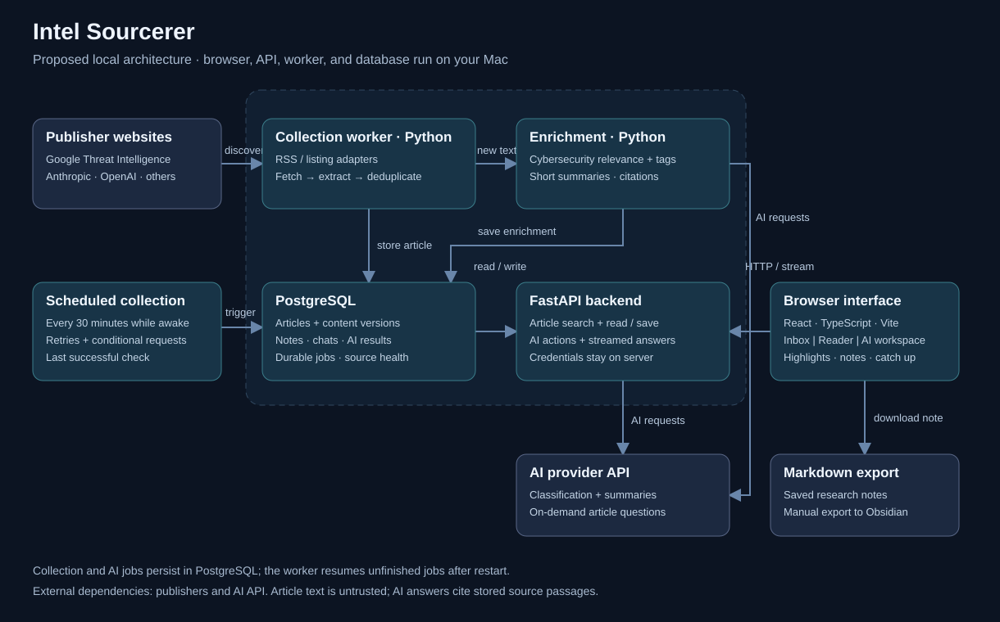
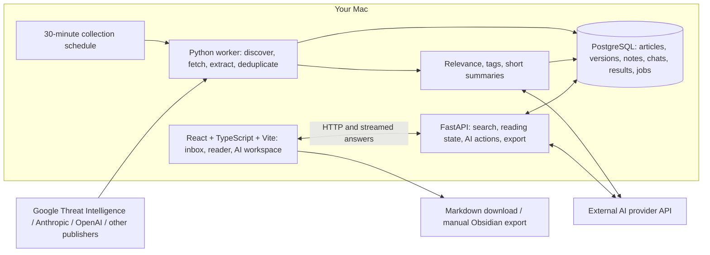

# Current runtime

The viewer and persistence service are independently deployable. See [hosting.md](hosting.md) for the current diagram, responsibilities, and commands. The design below is the earlier project proposal.

# Intel Sourcerer — proposed local architecture

This describes the planned application, not an implemented system.

## Runtime responsibilities

- Browser: article inbox, clean reader, highlights, notes, saved items, and article chat.
- API: article retrieval, full-text search, reading state, grounded AI actions, streamed responses, and Markdown export. AI credentials remain on the backend.
- Worker: scheduled RSS or listing checks, extraction, canonical URL deduplication, relevance classification, summaries, and retries. Persist jobs and statuses in PostgreSQL; prevent overlapping collection runs.
- Database: source configuration and health, article text and paragraph identifiers, publication/discovery times, content hashes and versions, topic tags, reading state, annotations, conversations, AI outputs, and pending jobs.
- AI provider: classify new content and answer questions using stored article passages. Cache outputs by article version, action, prompt version, and model. Deeper actions run on demand; lengthy actions use durable worker jobs.

## Local deployment

Use one project with frontend and backend directories. Run PostgreSQL through Docker Compose, plus the Python API and a separate worker process. Bind local services to loopback. Collection runs while the Mac and worker are awake; an always-on host can later use the same architecture.

Start with official feeds where available and listing adapters otherwise. Show extraction failures and last successful checks in the Sources screen. Preserve uncertain relevance matches. Treat article content as untrusted input, sanitize displayed content, and attach AI claims to source passages.

The first release uses an in-app new-article indicator. Daily digests and external notifications can be added later.
