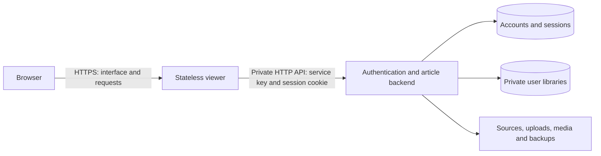

# Hosting the viewer separately

Intel Sourcerer runs authenticated and guest modes on one server by default.
For independent deployments, a viewer can run on a different machine
from the backend without receiving the database, account records, source TOML,
backups, or uploaded files.



## Local development

```sh
uv run intel-sourcerer-web
```

This command starts one HTTP server on `127.0.0.1:8765`. Sign in to use your
saved account, or choose **Continue as guest** for a temporary queue. Guest
articles and notes stay in browser session storage and are not added to account
libraries. Both modes share the same address; no private API port is needed.
Ctrl+C stops the server. Existing accounts and libraries are preserved.
Use `--host`, `--port`, `--database`, or `--config` to override defaults.

## Two independent processes

Generate a random secret, then configure the **same** `INTEL_BACKEND_KEY` on each
server through its environment or secret manager. Do not put it in frontend code
or commit it. Generate a value with:

```sh
uv run python -c 'import secrets; print(secrets.token_urlsafe(32))'
```

Start the backend on the machine holding the data:

```sh
# INTEL_BACKEND_KEY is already set in this process environment.
uv run intel-sourcerer-backend \
  --database /absolute/path/to/data/intel_sourcerer.sqlite3 \
  --config /absolute/path/to/config/sources.toml \
  --host 127.0.0.1 --port 8766
```

Start the viewer independently:

```sh
# INTEL_BACKEND_KEY is already set to the same value.
uv run intel-sourcerer-viewer \
  --backend-url http://127.0.0.1:8766 \
  --host 127.0.0.1 --port 8765
```

`INTEL_BACKEND_URL` can supply the backend origin instead of `--backend-url`.
The origin must have no path, embedded credentials, query, or fragment.

For separate machines, set `--backend-url` to the backend's private reachable
origin, and bind the backend to its private network interface using `--host`.
Keep it behind a firewall/private network; use HTTPS for traffic over an
untrusted network. All private backend routes require the service key in addition
to the user's session. `/health` exposes only service status.

Put the public viewer behind an HTTPS reverse proxy. Start the **backend** with
`--secure-cookies` when the public viewer uses HTTPS. That flag describes the
browser-facing URL, even when the internal connection is HTTP. The viewer uses
`--host` to select the interface your reverse proxy reaches. Default bindings
remain localhost. Do not expose the backend port as the browser's API origin.

## Responsibilities

| Service | Owns | Does not need |
| --- | --- | --- |
| Viewer (`viewer.py`) | HTML/templates, CSS, JavaScript, page rendering and forwarding requests | Database, passwords, session store, source TOML, uploaded files |
| Backend (`backend.py` / `web.py`) | Login/logout, account management, session validation, imports, notes, queues, stats, media and data persistence | Public UI hosting |

The viewer is a Python server that renders the existing templates and proxies
requests. It is not a static-only SPA: a CDN alone cannot replace its HTTP gateway.
It can be deployed and restarted independently. The backend is authoritative for
identity and ownership on every request; the viewer never accepts a browser's
claimed user ID as permission to access records.

Browser requests remain on the viewer origin, so no browser CORS allowlist or
cross-site cookies are needed. The backend's HttpOnly/SameSite session cookie is
forwarded to the browser without a Domain attribute. Its revocation and expiration
remain on the backend. The viewer uses request-local HTTP clients so a cookie jar
cannot mix users. Browser note drafts remain scoped to the user ID returned by the
backend. No user data is cached on the viewer.

Private media streams through the viewer, including byte-range requests for audio
and video. The viewer does not copy media to its disk. Uploads pass to the backend;
server filesystem path imports resolve on the **backend** machine, and remain
restricted to the administrator.

Static assets and `/health` work while the backend is offline. Private views and
API requests return a 502 response until connectivity returns; the saved articles
and sessions stay on the backend. Active editing still needs the backend online;
this change does not add offline synchronization.

## Data API used by the viewer

All these routes use `X-Intel-Service-Key` when the standalone backend is running.
User-specific routes also require the user's session cookie.

| Route | Result |
| --- | --- |
| `GET /api/viewer-session` | Safe user identity, CSRF token and first-account setup state; creates an anonymous session when needed |
| `POST /auth/*` | Existing setup, login, logout, password change and admin account creation |
| `GET /api/library` | Private article records used by the Library renderer |
| `GET /api/sources` | Personal source configuration as JSON |
| `GET /api/stats` | Read dates and completed reading sessions as JSON |
| Existing `/api/state`, `/api/article`, mutation and upload routes | Existing reader/queue behavior |
| `/local-media/*`, `/pdf-assets/*`, `/export` | Authenticated media and Markdown exports |

For standalone auth requests, `Accept: application/json` returns validation
messages to the viewer; successful authentication still returns local redirects
and session cookies. The old combined server factory remains available for
existing integrations/tests. The normal local command now uses the service split.

## Frontend-only temporary sessions

Supply articles directly to the viewer to bypass accounts, the API backend and
SQLite entirely. No `INTEL_BACKEND_KEY` is needed in this mode.

```sh
# One article (URL or local Markdown/HTML/text/PDF).
uv run intel-sourcerer-viewer --article ./report.md --port 8767

# Several articles, read in the supplied order.
uv run intel-sourcerer-viewer \
  --article ./report.md \
  --article ./second-report.pdf \
  --article https://example.com/research --port 8767

# Already-prepared articles, or a previous temporary-session export.
uv run intel-sourcerer-viewer --articles ./articles.json --port 8767
```

`intel-sourcerer-reader` is a shortcut for the same frontend-only mode, defaulting
to port 8767. It takes the same `--article` and `--articles` arguments. Neither
command needs a running authentication or database service.

JSON accepts a list or `{ "articles": [...] }`. Each article needs content:

```json
{
  "articles": [
    {"title": "First report", "url": "https://example.com/first", "markdown": "## Findings\n\n- First finding"},
    {"title": "Second report", "text": "The second article's full contents."}
  ]
}
```

Optional fields include `publisher`, `published_at` (ISO date/timestamp), `notes`,
`notes_format` (`plain`/`html`) and `is_read`. `content_markdown`, `content_text`,
`html`, and `body_html` are also accepted. HTML and rich notes are sanitized.

The frontend opens into the queue builder. Each browser tab keeps its own notes,
read status and navigation in `sessionStorage`, with no login and no backend API
requests. Refreshing retains that tab's session. Closing the tab discards it;
the tab can resume its temporary collection across viewer restarts. **Export articles &
notes** downloads JSON that can be supplied to a later temporary session. Timers,
automatic feed discovery and saved library management are excluded from this
mode. A finished queue can be rebuilt from the originally supplied articles.

URLs are fetched once by the startup loader; local files are read once. Markdown,
HTML, text, and selectable-text PDFs are supported. Temporary PDF loading uses the
text converter and does not persist extracted figures or local media assets.
External linked media follows the existing reader media toggle. The server keeps
only the normalized input payload in memory and serves frontend assets; it does
not store personal reading state. Like any unauthenticated temporary viewer, all
visitors can read the supplied articles, while their tab notes remain separate.
It binds to localhost by default.

## Choosing guest mode at sign-in

The sign-in and first-account setup screens include **Continue as guest**. It
opens `/guest`, where visitors can paste article Markdown/text or select Markdown,
HTML, text, PDF, or article JSON files. **Start reading** opens `/guest/read` using
the same frontend-only reader and browser-tab storage described above. Guests can
export notes, start a new guest queue, or follow **Sign in** to use a saved account.

Guest conversion uses the stateless viewer parser: the optional original URL labels
the article and is not fetched. Uploaded PDFs are converted in memory; no files,
notes, queues or accounts are saved on the server. Guest mode does not use the
authentication/backend API or grant access to saved libraries. Existing login
cookies remain separate from this temporary viewer. Guest routes also work when
the backend is unavailable; the error screen retains the guest option.

## Temporary queue builder and local sources

Temporary and guest viewers now open in the queue builder. Select, remove, reorder,
and rebuild queues from the tab's article collection, or return to it while
reading. Drop Markdown, HTML, text, JSON, or PDF files, or paste public article
links. Link imports cannot address local files or private network hosts.

Raw article sources (URL, Markdown, HTML or extracted PDF text) are kept in that
tab's `sessionStorage` alongside notes, read flags, and queue progress. On viewer
load, sources are sent to the viewer's stateless parser and normalized again;
existing notes and read flags are merged back by article URL. Supplied text is
reparsed locally by the viewer; URL-only sources are fetched again. The parser
returns results without storing them or contacting the authentication/database
backend. Fetching a public article uses a validated public destination and checks
each redirect. Exports include source records for restoring a later session.

The source filter groups articles by their session publisher metadata. Automatic
feed discovery remains a feature of the authenticated app. Closing the tab still ends the temporary collection, so
export work you want to retain. Browser storage limits can restrict large queues.
