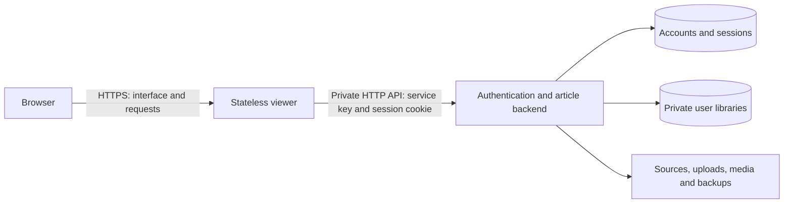

# Hosting the viewer separately

Intel Sourcerer runs authenticated and guest modes on one server by default.
For independent deployments, a viewer can run on a different machine
from the backend without receiving the database, account records, source TOML,
backups, or uploaded files.



## Local development

```sh
uv run intel-sourcerer-web
```

This command starts one HTTP server on `127.0.0.1:8765`. Sign in to use your
saved account, or choose **Continue as guest** for a temporary queue. Guest
articles and notes stay in browser session storage and are not added to account
libraries. Both modes share the same address; no private API port is needed.
Ctrl+C stops the server. Existing accounts and libraries are preserved.
Use `--host`, `--port`, `--database`, or `--config` to override defaults.

## Docker with persistent SQLite

From the project root:

```sh
docker compose up --build -d --wait
docker compose ps
```

Open <http://127.0.0.1:8775/>. Compose runs the combined web/API application as
`backend`, with the existing account and guest flows. It runs as UID/GID 10001,
uses the locked Python dependencies, and checks `/health` for readiness.
`INTEL_PORT` changes the published host port (default 8775, so it can run beside a local
server on 8765); the container always listens on 8765.

SQLite is an embedded database, so it uses a persistent named volume rather than
a database service. Compose mounts `intel-data` at `/app/data`; Docker normally
prefixes its name with the Compose project name. Accounts store absolute paths,
so keep this mount at `/app/data` when moving or restoring Docker data. Keep the
same Compose project name to reuse its volume. Local development data is separate
and is never mounted or copied automatically.

The image includes `config/sources.toml` as the initial source template. Account
creation copies that template into the writable data volume; personal source
toggles persist there. Changing the image's template affects newly created users.
Daily SQLite snapshots also remain inside the volume and do not protect against
deleting the volume or losing the Docker host.

### Back up and restore Docker data

Back up the entire data directory to keep accounts, personal source configuration,
media, and every user's library together. Stop the app for a consistent copy:

```sh
docker compose stop backend
docker compose cp backend:/app/data ./intel-docker-backup
docker compose start backend
```

Choose a new backup destination for each run and keep an additional copy on
separate storage. Treat the directory as private: it includes account records and
saved content. To restore, first back up the current Docker data as above. Restore
into an empty volume, using the same Compose project, image and `/app/data` mount:

```sh
# Create the stopped container and its empty volume on a fresh Docker deployment.
docker compose create backend
docker compose cp ./intel-docker-backup/. backend:/app/data
docker compose run --rm --no-deps --user root backend chown -R 10001:10001 /app/data
docker compose up -d --wait
```

Do not overlay a backup onto an existing data directory: stale SQLite sidecars or
files from newer accounts can survive. Verify sign-in, notes, queues and media
after restoring. These steps restore Docker backups; importing a host installation
also requires translating account database/config paths to `/app/data`.

### HTTPS and remote access

The default host binding is `127.0.0.1`, suitable for a reverse proxy on the Docker
host. Put remote access behind an HTTPS reverse proxy. When using HTTPS, add a
`compose.override.yaml` with:

```yaml
services:
  backend:
    command:
      - intel-sourcerer-web
      - --host
      - 0.0.0.0
      - --port
      - "8765"
      - --secure-cookies
```

Then run `docker compose up -d --wait`. The override keeps the volume and health
check, while enabling secure session cookies. Use ordinary HTTP localhost without
this override for local access.

## Running on the public internet

For the prepared GitHub Actions → GHCR → Lightsail deployment, use the
[production setup guide](lightsail.md). It includes a separate Compose stack
with Caddy, consistent backups, and failed-release recovery. The manual setup
below is useful when you already operate an HTTPS reverse proxy.

Run one container on a VM with a persistent local disk, behind an HTTPS reverse
proxy such as Caddy or nginx. SQLite needs a stable local disk and one writer, so
avoid platforms that replace or scale containers freely, and network file shares.

```sh
INTEL_TRUSTED_PROXIES=<proxy address> \
  docker compose -f compose.yaml -f compose.public.yaml up --build -d --wait
```

`compose.public.yaml` turns on secure cookies, turns off guest reading, makes the
filesystem read-only except the data volume and `/tmp`, drops all Linux
capabilities, and limits memory and processes.

| Setting | Purpose | Default |
| --- | --- | --- |
| `INTEL_TRUSTED_PROXIES` | Comma-separated proxy addresses or networks allowed to report the client through `X-Forwarded-For` and `X-Forwarded-Proto` | None; forwarded headers are ignored |
| `INTEL_SETUP_TOKEN` | Code required to create the first account | Random and printed to the log for standalone backends, with a trusted proxy, or when listening beyond localhost |
| `INTEL_SECURE_COOKIES` | Always mark session cookies Secure and send HSTS | Off, but on for requests a trusted proxy reports as HTTPS |
| `INTEL_GUEST` | Set to `off` to remove guest reading | On |
| `INTEL_MAX_CONNECTIONS` | Connections served at once; each direct client gets a quarter | 64 |

**Set `INTEL_TRUSTED_PROXIES` to the proxy's address as the container sees it, and
nothing wider.** The address appears at the start of each line in `docker compose logs
backend` when a request comes through the proxy. If it's too narrow, every visitor
shares one address and one attacker can trigger the login limits for everybody. If
it's too wide, clients can forge their address and avoid those limits.

**Set this even when the server listens on `127.0.0.1` behind a proxy on the same
machine.** Without a trusted proxy or `INTEL_SETUP_TOKEN`, a localhost server treats
first-run visitors as local and asks for no setup code, so a stranger could create
the administrator account through the proxy.

**Finish setup before opening the port.** Run `docker compose logs backend | grep "setup code"`
for the one-time code. It's only needed while no account exists.

### What the app protects against

- **Internal network access:** every outgoing fetch checks the address when the
  connection opens, including after redirects and for URLs in feeds. That covers DNS
  rebinding and cloud metadata addresses. It uses httpx internals and refuses to run
  if an upgrade moves them.
- **Slow or flooding clients:** quiet connections are dropped after 30 seconds, and
  connections past the limit get a 503.
- **Guest abuse:** guests get 120 fetched URLs per client every 10 minutes and three
  parses at once, if guest reading is on.
- **Upload memory:** each backend and viewer admits two uploads at once, keeping
  their slots through parsing, forwarding, and response handling.

### What still needs you

- Keep the proxy handling TLS and request limits. It's the better place to stop a client
  that sends bytes slowly enough to stay under the 30-second timeout.
- Send backups off the machine. Snapshots live in the same volume as the data.
- Scan images and pin base images by digest.
- Account limits are in memory or per address. Nothing here stops a distributed
  password-guessing attack beyond the per-account limit, and there's no two-factor sign-in.
- Article parsing runs on untrusted files, including PDFs. Container limits contain the
  damage but don't remove the risk, so keep the parsers updated.

## Two independent processes

Generate a random secret, then configure the **same** `INTEL_BACKEND_KEY` on each
server through its environment or secret manager. Do not put it in frontend code
or commit it. Generate a value with:

```sh
uv run python -c 'import secrets; print(secrets.token_urlsafe(32))'
```

Start the backend on the machine holding the data:

```sh
# INTEL_BACKEND_KEY is already set in this process environment.
uv run intel-sourcerer-backend \
  --database /absolute/path/to/data/intel_sourcerer.sqlite3 \
  --config /absolute/path/to/config/sources.toml \
  --host 127.0.0.1 --port 8766
```

Start the viewer independently:

```sh
# INTEL_BACKEND_KEY is already set to the same value.
uv run intel-sourcerer-viewer \
  --backend-url http://127.0.0.1:8766 \
  --host 127.0.0.1 --port 8765
```

First-account setup requires the one-time code from the backend log, even when
the backend binds to localhost. You can supply `INTEL_SETUP_TOKEN` through the
backend environment instead. This protects a private backend reached through a
public viewer.

`INTEL_BACKEND_URL` can supply the backend origin instead of `--backend-url`.
The origin must have no path, embedded credentials, query, or fragment.

For separate machines, set `--backend-url` to the backend's private reachable
origin, and bind the backend to its private network interface using `--host`.
Keep it behind a firewall/private network; use HTTPS for traffic over an
untrusted network. All private backend routes require the service key in addition
to the user's session. `/health` exposes only service status.

Put the public viewer behind an HTTPS reverse proxy. Start the **backend** with
`--secure-cookies` when the public viewer uses HTTPS. That flag describes the
browser-facing URL, even when the internal connection is HTTP. The viewer uses
`--host` to select the interface your reverse proxy reaches. Default bindings
remain localhost. Do not expose the backend port as the browser's API origin.

Alternatively, configure `INTEL_TRUSTED_PROXIES` on the **viewer** to the address
of its HTTPS reverse proxy. The viewer then validates HTTPS forwarding headers,
sets HSTS, and sends the validated browser scheme to the backend with its service
key. The backend accepts this metadata only from an authenticated viewer.
`INTEL_SECURE_COOKIES=1` on the viewer forces HTTPS behavior when proxy-based
detection is not used.

## Responsibilities

| Service | Owns | Does not need |
| --- | --- | --- |
| Viewer (`viewer.py`) | HTML/templates, CSS, JavaScript, page rendering and forwarding requests | Database, passwords, session store, source TOML, uploaded files |
| Backend (`backend.py` / `web.py`) | Login/logout, account management, session validation, imports, notes, queues, stats, media and data persistence | Public UI hosting |

The viewer is a Python server that renders the existing templates and proxies
requests. It is not a static-only SPA: a CDN alone cannot replace its HTTP gateway.
It can be deployed and restarted independently. The backend is authoritative for
identity and ownership on every request; the viewer never accepts a browser's
claimed user ID as permission to access records.

Browser requests remain on the viewer origin, so no browser CORS allowlist or
cross-site cookies are needed. The backend's HttpOnly/SameSite session cookie is
forwarded to the browser without a Domain attribute. Its revocation and expiration
remain on the backend. The viewer uses request-local HTTP clients so a cookie jar
cannot mix users. Browser note drafts remain scoped to the user ID returned by the
backend. No user data is cached on the viewer.

Private media streams through the viewer, including byte-range requests for audio
and video. The viewer does not copy media to its disk. Uploads pass to the backend;
server filesystem path imports resolve on the **backend** machine, and remain
restricted to the administrator.

Static assets and `/health` work while the backend is offline. Private views and
API requests return a 502 response until connectivity returns; the saved articles
and sessions stay on the backend. Active editing still needs the backend online;
this change does not add offline synchronization.

## Data API used by the viewer

All these routes use `X-Intel-Service-Key` when the standalone backend is running.
User-specific routes also require the user's session cookie.

| Route | Result |
| --- | --- |
| `GET /api/viewer-session` | Safe user identity, CSRF token and first-account setup state; creates an anonymous session when needed |
| `POST /auth/*` | Existing setup, login, logout, password change and admin account creation |
| `GET /api/library` | Private article records used by the Library renderer |
| `GET /api/sources` | Personal source configuration as JSON |
| `GET /api/stats` | Read dates and completed reading sessions as JSON |
| Existing `/api/state`, `/api/article`, mutation and upload routes | Existing reader/queue behavior |
| `/local-media/*`, `/pdf-assets/*`, `/export` | Authenticated media and Markdown exports |

For standalone auth requests, `Accept: application/json` returns validation
messages to the viewer; successful authentication still returns local redirects
and session cookies. The old combined server factory remains available for
existing integrations/tests. The normal local command now uses the service split.

## Frontend-only temporary sessions

Supply articles directly to the viewer to bypass accounts, the API backend and
SQLite entirely. No `INTEL_BACKEND_KEY` is needed in this mode.

```sh
# One article (URL or local Markdown/HTML/text/PDF).
uv run intel-sourcerer-viewer --article ./report.md --port 8767

# Several articles, read in the supplied order.
uv run intel-sourcerer-viewer \
  --article ./report.md \
  --article ./second-report.pdf \
  --article https://example.com/research --port 8767

# Already-prepared articles, or a previous temporary-session export.
uv run intel-sourcerer-viewer --articles ./articles.json --port 8767
```

`intel-sourcerer-reader` is a shortcut for the same frontend-only mode, defaulting
to port 8767. It takes the same `--article` and `--articles` arguments. Neither
command needs a running authentication or database service.

JSON accepts a list or `{ "articles": [...] }`. Each article needs content:

```json
{
  "articles": [
    {"title": "First report", "url": "https://example.com/first", "markdown": "## Findings\n\n- First finding"},
    {"title": "Second report", "text": "The second article's full contents."}
  ]
}
```

Optional fields include `publisher`, `published_at` (ISO date/timestamp), `notes`,
`notes_format` (`plain`/`html`) and `is_read`. `content_markdown`, `content_text`,
`html`, and `body_html` are also accepted. HTML and rich notes are sanitized.

The frontend opens into the queue builder. Each browser tab keeps its own notes,
read status and navigation in `sessionStorage`, with no login and no backend API
requests. Refreshing retains that tab's session. Closing the tab discards it;
the tab can resume its temporary collection across viewer restarts. **Export articles &
notes** downloads JSON that can be supplied to a later temporary session. Timers,
automatic feed discovery and saved library management are excluded from this
mode. A finished queue can be rebuilt from the originally supplied articles.

URLs are fetched once by the startup loader; local files are read once. Markdown,
HTML, text, and selectable-text PDFs are supported. Temporary PDF loading uses the
text converter and does not persist extracted figures or local media assets.
External linked media follows the existing reader media toggle. The server keeps
only the normalized input payload in memory and serves frontend assets; it does
not store personal reading state. Like any unauthenticated temporary viewer, all
visitors can read the supplied articles, while their tab notes remain separate.
It binds to localhost by default.

## Choosing guest mode at sign-in

The sign-in and first-account setup screens include **Continue as guest**. It
opens `/guest`, where visitors can paste article Markdown/text or select Markdown,
HTML, text, PDF, or article JSON files. **Start reading** opens `/guest/read` using
the same frontend-only reader and browser-tab storage described above. Guests can
export notes, start a new guest queue, or follow **Sign in** to use a saved account.

Guest conversion uses the stateless viewer parser: the optional original URL labels
the article and is not fetched. Uploaded PDFs are converted in memory; no files,
notes, queues or accounts are saved on the server. Guest mode does not use the
authentication/backend API or grant access to saved libraries. Existing login
cookies remain separate from this temporary viewer. Guest routes also work when
the backend is unavailable; the error screen retains the guest option.

## Temporary queue builder and local sources

Temporary and guest viewers now open in the queue builder. Select, remove, reorder,
and rebuild queues from the tab's article collection, or return to it while
reading. Drop Markdown, HTML, text, JSON, or PDF files, or paste public article
links. Link imports cannot address local files or private network hosts.

Raw article sources (URL, Markdown, HTML or extracted PDF text) are kept in that
tab's `sessionStorage` alongside notes, read flags, and queue progress. On viewer
load, sources are sent to the viewer's stateless parser and normalized again;
existing notes and read flags are merged back by article URL. Supplied text is
reparsed locally by the viewer; URL-only sources are fetched again. The parser
returns results without storing them or contacting the authentication/database
backend. Fetching a public article uses a validated public destination and checks
each redirect. Exports include source records for restoring a later session.

The source filter groups articles by their session publisher metadata. Automatic
feed discovery remains a feature of the authenticated app. Closing the tab still ends the temporary collection, so
export work you want to retain. Browser storage limits can restrict large queues.
